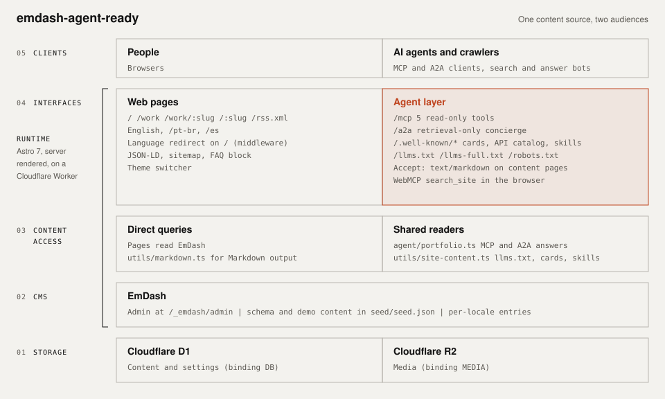

# emdash-agent-ready

A starter for developers building a portfolio or small business site that AI agents can query, not only people. The conventions agents use (MCP, A2A, discovery files, `llms.txt`) come from separate specifications; this wires them to one content source on [EmDash](https://github.com/emdash-cms/emdash) (Astro) and Cloudflare Workers.

It builds on EmDash's MIT-licensed [portfolio template](https://github.com/emdash-cms/templates) and adds localization, search metadata and an agent layer.

Status: early. No automated tests yet.



## What it adds

The template already provides project pages, tag filtering, RSS, basic SEO metadata and dark/light mode. This starter adds:

| Area | What you get |
|---|---|
| MCP | Read-only server at `/mcp`: `list_projects`, `get_project`, `get_page`, `search_portfolio`, `get_contact_info` |
| A2A | Retrieval-only concierge at `/a2a`, with an agent card |
| Discovery | `/.well-known/` MCP server card, agent card, API catalog (RFC 9727) and agent skills index |
| Text for agents | `/llms.txt`, `/llms-full.txt`, Markdown content negotiation |
| In the browser | WebMCP `search_site` tool |
| Crawlers | `robots.txt` that allows search and answer engines and blocks training bots |
| SEO | Extended structured data, locale-aware sitemap, FAQ block |
| Languages | English, Brazilian Portuguese, Spanish |

The demo content is a fictional studio (Norma). Only part of it is translated, so the other pages show the English fallback.

## Run it locally

Needs Node 22.23.4 or newer, and Bun.

```bash
bun install
bun dev
```

Open http://localhost:4321/_emdash/admin and complete the setup wizard. The first start can take a few minutes (migrations and seed).

> **Warning:** never expose the dev server to the internet (no tunnels or public hosts). Development mode has a login bypass and open first-user setup, so anyone who reaches it can become admin.

## Try the agent layer

With the dev server running and setup complete.

MCP, search the content:

```bash
curl -s http://localhost:4321/mcp \
  -H 'Content-Type: application/json' \
  -H 'Accept: application/json, text/event-stream' \
  -H 'MCP-Protocol-Version: 2025-06-18' \
  -d '{"jsonrpc":"2.0","id":1,"method":"tools/call","params":{"name":"search_portfolio","arguments":{"query":"identity"}}}'
```

Response, trimmed:

```text
event: message
data: {"result":{"content":[{"type":"text","text":"- **Concrete Futures** — http://localhost:4321/work/concrete-futures\n ...
```

A2A, ask a question:

```bash
curl -s http://localhost:4321/a2a \
  -H 'Content-Type: application/json' \
  -H 'A2A-Version: 1.0' \
  -d '{"jsonrpc":"2.0","id":1,"method":"SendMessage","params":{"message":{"messageId":"m1","role":"ROLE_USER","parts":[{"text":"How can I hire you?"}]}}}'
```

Response, trimmed:

```text
{"jsonrpc":"2.0","id":1,"result":{"message":{"role":"ROLE_AGENT","parts":[{"text":"_Answer taken from the published site content; nothing here is generated._\n\nSource: http://localhost:4321/contact\n\n# Contact ...
```

## Checks

```bash
bun run typecheck
bun run build
```

`@emnapi/runtime` is pinned in `package.json` because `astro check` crashes when a 2.x version is resolved instead.

## Where to edit

| Path | Contents |
|---|---|
| `src/agent/` | Answers shared by MCP and A2A, the concierge, agent skills |
| `src/endpoints/` | MCP, A2A and `/.well-known/` routes (registered in `astro.config.mjs`) |
| `src/pages/` | Web pages, `llms.txt`, `robots.txt`, sitemaps, RSS |
| `src/seo/` | Structured data |
| `src/i18n/` | Locales and interface strings |
| `seed/seed.json` | Content model, demo content, translations |

## Before you deploy

- Choose your own Worker, D1 and R2 names in `wrangler.jsonc`.
- Set the site URL in the EmDash settings, and `ENTITY_TYPE` in `src/seo/config.ts`.
- Review the crawler policy in `src/pages/robots.txt.ts`.
- Add edge rate limits on `/mcp` and `/a2a`. Both are public.

```bash
bun wrangler login
bun run deploy
```

## License

MIT. Original template copyright Cloudflare Inc.; see [LICENSE](LICENSE).
